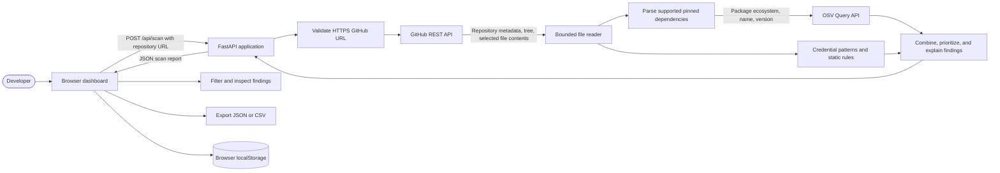

# TraceGuard

TraceGuard is a small security analysis dashboard for **public GitHub repositories**. Enter a repository URL to check supported pinned dependencies against the OSV vulnerability database, look for selected credential patterns, and flag a few risky code patterns. Findings are grouped by severity and include evidence and suggested next steps.

> TraceGuard is an early MVP and review aid, not a complete security audit. A clean report does not prove that a repository is secure.

## Contents

- [Features](#features)
- [Architecture](#architecture)
- [Technology](#technology)
- [Run locally](#run-locally)
- [Configuration](#configuration)
- [Use the scanner API](#use-the-scanner-api)
- [What is scanned](#what-is-scanned)
- [Limits and security notes](#limits-and-security-notes)
- [Project layout](#project-layout)
- [Troubleshooting](#troubleshooting)

## Features

- Reads public repository metadata and selected files through the GitHub REST API.
- Checks pinned dependencies in supported lockfiles against OSV advisories.
- Detects several common credential shapes. The matching value is not included in the finding returned to the browser.
- Applies a small set of static code rules for potentially risky patterns.
- Sorts findings by severity and provides evidence, a suggested action, and an evidence-grounded explanation.
- Filters findings by category and severity; exports reports as JSON or CSV.
- Keeps up to 12 recent scan results in the current browser's `localStorage`.
- Does not execute repository code.

## Architecture



The browser sends a repository URL to the FastAPI backend. The backend validates the URL, asks GitHub for repository metadata and a file tree, then fetches a bounded set of eligible files. It parses supported lockfiles and sends only dependency coordinates (ecosystem, package name, and version) to OSV. Secret and static rules run against the retrieved file contents on the backend. The backend returns normalized report data to the browser; report filtering, export, and scan history are handled in the browser.

The explanations are deterministic text based on the scanner result and its remediation rule. This version does **not** call Gemini or another generative AI service.

## Technology

| Area | Implementation |
| --- | --- |
| API and server | Python, FastAPI, Uvicorn |
| Dashboard | HTML, CSS, and JavaScript served by FastAPI |
| Dependency intelligence | OSV Query API |
| Repository access | GitHub REST API |
| Scan history | Browser `localStorage` |

There is no frontend build step or database in this version.

## Run locally

Requires Python 3.10 or newer and an internet connection to reach GitHub and OSV.

To start from a fresh checkout:

```bash
git clone https://github.com/gireeshpatgar17/TraceGuard.git
cd TraceGuard
```

### Windows PowerShell

```powershell
cd 'C:\path\to\TraceGuard'
python -m venv .venv
.\.venv\Scripts\Activate.ps1
python -m pip install -r requirements.txt
uvicorn app.main:app --reload
```

### macOS or Linux

```bash
cd /path/to/TraceGuard
python3 -m venv .venv
source .venv/bin/activate
python -m pip install -r requirements.txt
uvicorn app.main:app --reload
```

Open [http://127.0.0.1:8000](http://127.0.0.1:8000) for the dashboard. FastAPI's interactive API documentation is at [http://127.0.0.1:8000/docs](http://127.0.0.1:8000/docs), and the health endpoint is [http://127.0.0.1:8000/api/health](http://127.0.0.1:8000/api/health).

To stop the server, press `Ctrl+C` in the terminal.

## Configuration

| Variable | Required | Purpose |
| --- | --- | --- |
| `GITHUB_TOKEN` | No | Authenticates GitHub REST API requests and raises the API rate limit for public repository scans. |

Set it only in your local environment; never commit a real token. In PowerShell, set it for the current terminal session with:

```powershell
$env:GITHUB_TOKEN = "your-github-token"
uvicorn app.main:app --reload
```

In macOS/Linux:

```bash
export GITHUB_TOKEN="your-github-token"
uvicorn app.main:app --reload
```

The `.env.example` file is only a placeholder. If you use a local `.env` file, start Uvicorn with `--env-file .env`; `.env` is excluded by `.gitignore`.

## Use the scanner API

The dashboard calls this endpoint automatically. You can also submit a scan directly:

```http
POST /api/scan
Content-Type: application/json

{
  "repository_url": "https://github.com/owner/repository"
}
```

Example with `curl`:

```bash
curl -X POST http://127.0.0.1:8000/api/scan \
  -H "Content-Type: application/json" \
  -d '{"repository_url":"https://github.com/octocat/Hello-World"}'
```

The response includes repository metadata, scan time, number of files and dependencies scanned, severity totals, findings, coverage notes, and any scanner evidence. Invalid URLs return an HTTP 400 response; missing or private repositories return 404; GitHub rate limiting returns 429; unsupported upstream or oversized repository responses may return 502 or 413.

## What is scanned

### Dependency advisories

TraceGuard extracts pinned versions from these files and queries OSV:

| File | Ecosystem |
| --- | --- |
| `package-lock.json`, `npm-shrinkwrap.json` | npm |
| `requirements.txt`, `poetry.lock`, `Pipfile.lock` | PyPI |
| `Cargo.lock` | crates.io |
| `go.sum` | Go |
| `Gemfile.lock` | RubyGems |

For `requirements.txt`, only `name==version` lines are recognized. Dependency versions must be present in a supported lockfile or pinned requirement format. A manifest not listed above may be retrieved as a file but is not used for dependency lookup.

### Credential patterns

The current rules look for AWS access key IDs, common GitHub token formats, private-key headers, and selected quoted assignments that resemble API keys, secrets, passwords, or access tokens. The matched secret value is not placed in the finding evidence. These patterns can miss secrets or flag example values; rotate a real exposed credential immediately.

### Static rules

The current rules flag selected patterns related to SQL string formatting, disabled TLS certificate verification, dynamic `eval`, and debug mode. These are heuristics for manual review, not full language-aware analysis.

## Limits and security notes

- Only HTTPS URLs hosted on `github.com` or `www.github.com` are accepted. Private repositories are not supported.
- Repository code is retrieved for inspection but is never executed.
- The scanner considers at most 350 eligible files, skips common vendor/build folders, ignores individual files above 180 KB, and stops reading after approximately 5 MB of file content. Very large repositories may be rejected or only partially represented.
- GitHub API rate limits apply. Configure `GITHUB_TOKEN` if anonymous requests are throttled. A scan makes individual content requests, so repositories with many files can use the rate limit quickly.
- OSV or GitHub outages can prevent or limit results. An OSV lookup failure may result in missing dependency findings; treat an incomplete scan as inconclusive.
- Dependency matching is limited to the parsers above and the first 180 extracted dependencies per scan.
- Secret and static checks have limited rule coverage and can produce false positives or false negatives. Review the source and upstream advisory before acting.
- Findings and severity labels are guidance, not proof of exploitability or absence of risk.
- Scan history is local to a browser profile; there are no accounts, shared database, or server-side scan history.

## Project layout

```text
TraceGuard/
├── app/
│   ├── __init__.py
│   └── main.py          # FastAPI routes, GitHub/OSV access, parsing, and scan rules
├── static/
│   ├── index.html       # Dashboard page
│   ├── styles.css       # Responsive dashboard styles
│   └── app.js           # Scan UI, filters, history, and report export
├── .env.example        # Optional configuration placeholder; no secret values
├── .gitignore
├── README.md
└── requirements.txt
```

## Troubleshooting

| Symptom | What to check |
| --- | --- |
| `ModuleNotFoundError` when starting | Activate `.venv`, then run `python -m pip install -r requirements.txt`. |
| GitHub returns 404 | Confirm the URL is correct and the repository is public. |
| GitHub returns 429 | Set `GITHUB_TOKEN` and restart the server. |
| Scan returns 413 | The repository tree is truncated or exceeds the scan size limits. |
| No dependency findings | Check that the repository has one of the supported lockfiles with pinned versions. |
| Dashboard cannot reach the API | Keep the Uvicorn server running and use the same local address and port shown in its startup message. |

## License

No license is currently included. Add a license file if you want to specify how others may use, modify, and distribute this project.
